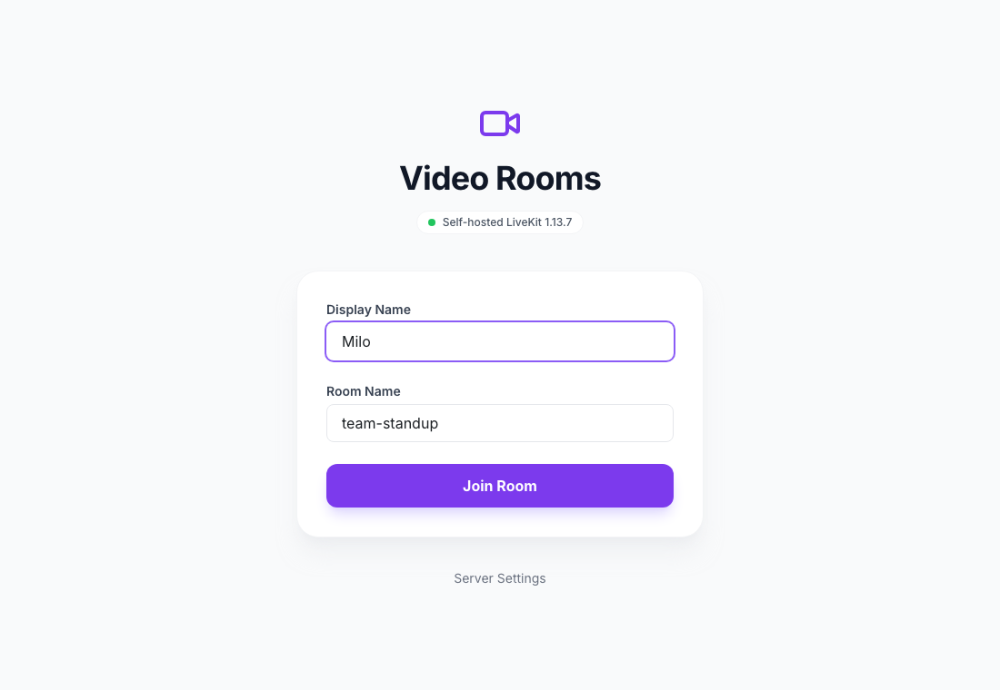
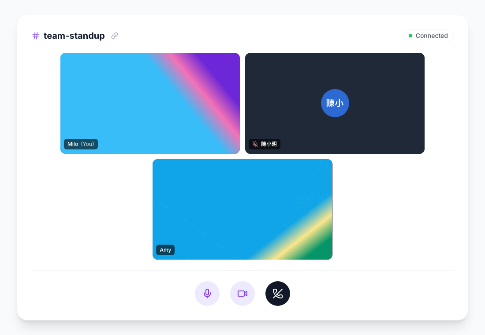
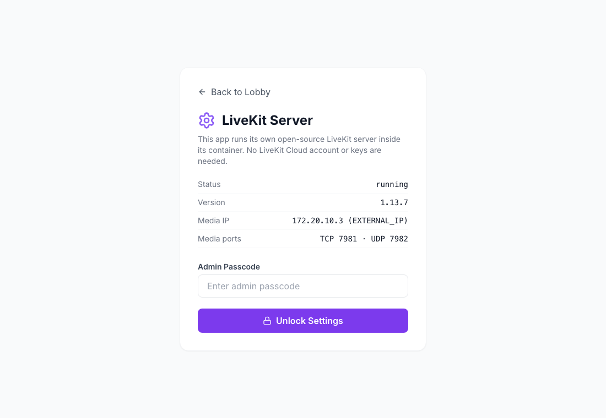

# Reflex DDNS LiveKit Video Chat 🎥

Real-time video rooms (camera + microphone) built with [Reflex](https://reflex.dev/) on a **self-hosted, open-source [LiveKit](https://github.com/livekit/livekit) server that runs inside the app's own container**. There is no LiveKit Cloud account, no API key to paste and nothing to configure: install it on [re-ddns](https://github.com/milochen0418/re_ddns) and everyone on your network can meet face to face at `https://video-chat.reflex-ddns.com`.

This is the video sibling of [reflex_ddns_livekit_audio_chat](https://github.com/milochen0418/reflex_ddns_livekit_audio_chat): the same lobby, embedded server, `/settings` page and `call.join` intent, with everyone's camera in a video grid. The two apps can be installed side by side because they use different media ports.

## 📸 Interface Preview

| Lobby | Video room | Server status |
|:---:|:---:|:---:|
|  |  |  |

## 🌟 Features

- **Lobby**: display name + room name. Invite links (`/?room=<name>`) prefill the room.
- **Video room**: a grid of everyone's camera that adapts to the number of people. Your own view is mirrored. While someone's camera is off, their tile shows an avatar. A green frame marks whoever is speaking, and each tile shows a live microphone level and a mute icon.
- **Camera and microphone controls**: turning the camera off releases the device, so its light goes off. You can also mute/unmute, leave, and copy the invite link.
- **Robust media**: camera and microphone are requested with a single permission prompt. If you only have one of them, or neither, you still join and can see and hear the others. Remote audio elements stay in the DOM, and a *Click to enable audio* button appears when the browser blocks autoplay. Others' video arrives at the resolution of their tile (simulcast + adaptive stream).
- **Embedded LiveKit server**: the app downloads (on Linux), starts, supervises and restarts it. API keys are generated on first start.
- **Calls for other apps**: the `call.join` [DDNS Intent](#-calls-from-other-apps-ddns-intent-calljoin) lets apps such as relack and codoc_in_md open a video call in a dialog.
- **`/settings`**: server status for everyone. With `ADMIN_PASSCODE`, admins also get the values other apps need (URL, API key/secret), a media IP override, a restart button and the server log.
- **No CDN at runtime**: `livekit-client` is vendored in `assets/`, avatars are generated locally.

## 📐 How it works

```
Browser ── https://video-chat.reflex-ddns.com ──► re-ddns nginx (TLS, local CA)
  │           /, assets            → Reflex frontend :3000
  │           /_event              → Reflex backend  :8000
  │           /rtc, /twirp/        → Reflex backend  :8000 ─ relay ─► livekit-server 127.0.0.1:7980
  │
  └─ WebRTC video + audio ── UDP 7982 / TCP 7981, published on the Docker host ──► livekit-server
                             (advertised as rtc.node_ip = EXTERNAL_IP, the host's LAN IP)

smart-app-video-chat container
 ├─ reflex run  (frontend :3000, backend :8000)
 │    └─ lifespan task: get livekit-server, write config, start + supervise it
 └─ livekit-server (Apache-2.0)  :7980 localhost only · :7981/tcp · :7982/udp
```

| File | Role |
|------|------|
| `reflex_ddns_livekit_video_chat/livekit_server.py` | Finds or downloads `livekit-server` (pinned release, checksum-verified), generates keys, writes the config, starts and supervises the process. The server runs detached, so Reflex hot reloads don't drop calls. |
| `reflex_ddns_livekit_video_chat/livekit_proxy.py` | Same-origin relay on the Reflex backend: WebSocket `/rtc` + `/rtc/v1`, HTTP `/rtc/.../validate` and `/twirp/...` to `127.0.0.1:7980`. |
| `reflex_ddns_livekit_video_chat/livekit_bridge.py` + `assets/livekit_bridge.js` | Reflex state ↔ LiveKit JS client: token minting, join/leave/mute/camera, room events back into Reflex state. Reflex renders the video tiles; the bridge attaches each camera track to the `<video>` of its tile and attaches it again whenever React re-renders the tile. |
| `backend-paths.txt` | Tells re-ddns nginx to send `/rtc` and `/twirp/` to the backend port. |

Signalling therefore goes through the same HTTPS origin as the page. Only the media ports must be published, because nginx cannot proxy WebRTC media. They sit 100 above the audio chat app's (7880-7882), so both apps and their servers can run on the same host.

## 🚀 Install on re-ddns (Agentic App Store)

The App Store catalog (`re_ddns/data/appstore_catalog.json`) has an entry for this app:

```json
{
  "id": "ddns-livekit-video-chat",
  "subdomain": "video-chat",
  "github_repo": "https://github.com/milochen0418/reflex_ddns_livekit_video_chat.git",
  "app_name": "reflex_ddns_livekit_video_chat",
  "ports": ["7981:7981", "7982:7982/udp"]
}
```

1. Open `https://aapps.reflex-ddns.com` and install **LiveKit Video Chat (self-hosted)**. The admin passcode is optional.
2. Open `https://video-chat.reflex-ddns.com`, pick a name and a room, allow camera and microphone, and share the invite link.

The first start downloads `livekit-server` (about 17 MB) from GitHub releases. This needs a re-ddns version whose App Store supports the catalog `ports` field and passes `EXTERNAL_IP` to apps.

From the command line:

```bash
./smart_launch.sh -p 7981:7981 -p 7982:7982/udp \
  https://github.com/milochen0418/reflex_ddns_livekit_video_chat.git reflex_ddns_livekit_video_chat video-chat
```

## 💻 Run locally

Prerequisites: Python 3.11, [Poetry](https://python-poetry.org/docs/#installation) and the LiveKit server binary. On macOS install it with `brew install livekit`; LiveKit publishes no macOS release binaries, while Linux downloads them automatically.

```bash
poetry env use python3.11
poetry install
poetry run ./reflex_rerun.sh
```

Open `http://localhost:3000`. The browser connects to LiveKit via `ws://localhost:8000/rtc` and media goes to the machine's own addresses. Browsers only allow the camera and microphone on secure origins: `localhost` counts as one, but from another machine use HTTPS, e.g. through re-ddns.

`reflex_rerun.sh` also stops the detached `livekit-server` (port 7980) so the restarted backend starts a fresh one. Runtime files (binary, keys, config, `livekit-server.log`) live in `~/Library/Application Support/reflex_ddns_livekit_video_chat` on macOS and in `~/.local/share/reflex_ddns_livekit_video_chat` on Linux.

> If the Docker deployment runs on the same machine, it owns ports 7981/7982. Run the local copy on other media ports:
> `LIVEKIT_RTC_TCP_PORT=7991 LIVEKIT_RTC_UDP_PORT=7992 poetry run ./reflex_rerun.sh`

## ⚙️ Configuration (all optional)

| Variable | Default | Purpose |
|----------|---------|---------|
| `ADMIN_PASSCODE` | *(empty)* | Unlocks the admin part of `/settings`. |
| `LIVEKIT_NODE_IP` | `EXTERNAL_IP`, else auto | IP address browsers send video and audio to (`rtc.node_ip`). It can also be set on `/settings`. |
| `LIVEKIT_API_KEY` / `LIVEKIT_API_SECRET` | generated | Fixed credentials, e.g. to share the server with other apps. The secret needs 32+ characters. |
| `LIVEKIT_RTC_TCP_PORT` / `LIVEKIT_RTC_UDP_PORT` | `7981` / `7982` | ICE/TCP port and ICE/UDP mux port. These must match the published ports. |
| `LIVEKIT_PORT` | `7980` | Signalling/API port (localhost only). |
| `LIVEKIT_SERVER_BIN` | PATH, then download | Use a specific `livekit-server` binary. |
| `LIVEKIT_SERVER_VERSION` | `1.13.7` | Release downloaded on Linux. |
| `LIVEKIT_HOME` | see above | Directory for runtime files. |
| `LIVEKIT_PUBLIC_URL` | the app's `api_url` | LiveKit URL handed to browsers. |
| `LIVEKIT_LOG_LEVEL` | `info` | livekit-server log level. |

## 🔗 Use this server from other *.reflex-ddns.com apps

The embedded server is a normal LiveKit server, so any LiveKit SDK can join the same rooms:

- **Client SDKs** (browser, mobile): `wss://video-chat.reflex-ddns.com`
- **Server SDKs** (tokens, RoomService): `https://video-chat.reflex-ddns.com` from the LAN, or `http://smart-app-video-chat:8000` from containers on the re-ddns network
- **API key / secret**: shown on `/settings` (admin). You can also choose them yourself with `LIVEKIT_API_KEY` / `LIVEKIT_API_SECRET`.

```python
from livekit import api

token = (
    api.AccessToken(API_KEY, API_SECRET)
    .with_identity("relack-user-42").with_name("Amy")
    .with_grants(api.VideoGrants(room_join=True, room="team-standup"))
    .to_jwt()
)
# Browser: new LivekitClient.Room().connect("wss://video-chat.reflex-ddns.com", token)
```

## 📞 Calls from other apps (DDNS Intent `call.join`)

This app implements the same `call.join` contract as the audio chat app, so callers such as relack and codoc_in_md need no change. Other *.reflex-ddns.com apps open a call in a dialog with [reflex_ddns_auth](https://github.com/milochen0418/reflex_ddns_auth)'s intents. The dialog loads `/intent/call-join`, which joins the LiveKit room right away with camera and microphone on, and answers the caller when the user hangs up:

```python
from reflex_ddns_auth.intent import Intent, intent_host

rx.button("Call", on_click=Intent.start(
    None, "call.join",              # None: whichever installed app provides call.join
    on_result=MyState.call_ended,   # {"status": "ended", "room": <room>} after hang up
    on_cancel=MyState.call_ended,   # {"reason": "closed" | "cancel" | "replaced" | ..., ...} otherwise
    private={"room": call_id},      # posted to the dialog, kept out of the URL
    keep_alive=True,                # other dialogs minimize the call instead of ending it
    single=True,                    # one call at a time: a new call closes the previous one
    label="Call · Design Review",   # shown in the tray while minimized
    title="Design Review", user="amy@example.com", name="Amy",
))
intent_host()  # once per page; delegates camera, microphone + autoplay to the dialog
```

| Param | Meaning |
|-------|---------|
| `room` | Required. Call id, used as the LiveKit room name. Everyone opening the same `room` is in the same call. Use an unguessable id for private calls: the rooms themselves have no access control. Pass it with `private=` so it stays out of URLs and logs. |
| `title` | Shown instead of the id (e.g. the chat room's name). |
| `name` | Display name of the participant. |
| `user` | Stable account id (e.g. an email), the base of the participant identity. |

The params are declared on the intent (`params=`, `required=("room",)`): a call without `room` shows an error, and Close answers `cancel` with `{"error": ...}`. The app also publishes this contract, titled *Video Call*, at `/_ddns_intent/manifest`, which the re-ddns intent registry reads, so callers find this app without naming it.

**Audio or video?** When this app and the audio chat app are both installed, the registry reports both as providers of `call.join`, and the caller's dialog first asks which one to use (*Open with*: `livekit` for audio, `video-chat` for video). Each app runs its own LiveKit server, so **everyone in a call has to pick the same app**: if one person picks audio and another picks video, they end up in two separate rooms. To skip the question, name the app in the caller: `Intent.start("video-chat", "call.join", ...)`, or set `RELACK_CALL_APP=video-chat` on relack or `CODOC_CALL_APP=video-chat` on codoc_in_md. For local development of a caller without the registry, use `DDNS_INTENT_PROVIDER_CALL_JOIN=video-chat DDNS_INTENT_URL_VIDEO_CHAT=http://localhost:3300`.

## 🧪 Tests

Playwright suites live in `testcases/` (see [testcases/README.md](testcases/README.md)):

```bash
poetry run ./run_test_suite.sh smoke_home        # lobby + server running + /rtc relay
poetry run ./run_test_suite.sh two_users_video   # 2 browsers see + hear each other; camera off/on, mute, leave
ADMIN_PASSCODE=test-pass poetry run ./run_test_suite.sh settings_admin
poetry run ./run_test_suite.sh call_intent       # call.join opened by a fake caller app
```

`two_users_video` uses Chromium's fake camera and microphone. It checks that inbound audio and video bytes keep growing and that the other person's tile plays decoded frames. It also checks that turning the camera off releases it. The test prints the selected ICE pair, so you can see which server port carries the media.

## 🩺 Troubleshooting

| Symptom | Fix |
|---------|-----|
| Joined but no picture or sound, or stuck on *Connecting...* | Media can't reach the server. On `/settings`, *Media IP* must be the Docker host's LAN IP and the media ports must be published (`docker port smart-app-video-chat`). Allow UDP 7982 / TCP 7981 in the host firewall. |
| *address already in use* in the status | Another LiveKit instance holds 7981/7982 (e.g. the Docker deployment and a local run on the same Mac). Use other ports, see above. |
| *livekit-server not found on PATH* | macOS: `brew install livekit`. |
| *Joined without camera* / *without microphone* | Permission was denied, no device exists, or another app holds the camera. You can still see and hear the others. Allow access in the browser's site settings, then turn the camera on again. |
| No camera prompt when opening the page from another machine over `http://` | Browsers only give camera and microphone to secure origins. Use `https://video-chat.reflex-ddns.com` (or `localhost`). |
| Someone's video is blurry for the first seconds | Adaptive stream starts at a low resolution and raises it to fit the tile. |
| *Click to enable audio* button | The browser blocked autoplay. Click it once. |
| Two people "in the same call" can't see each other | One of them opened it with the audio chat app. See [Audio or video?](#-calls-from-other-apps-ddns-intent-calljoin). |

## 📄 License

MIT, see [LICENSE](LICENSE). The bundled [livekit-client](https://github.com/livekit/client-sdk-js) (`assets/livekit-client.umd.js`, v2.22.3) and the downloaded [livekit-server](https://github.com/livekit/livekit) are Apache-2.0.
